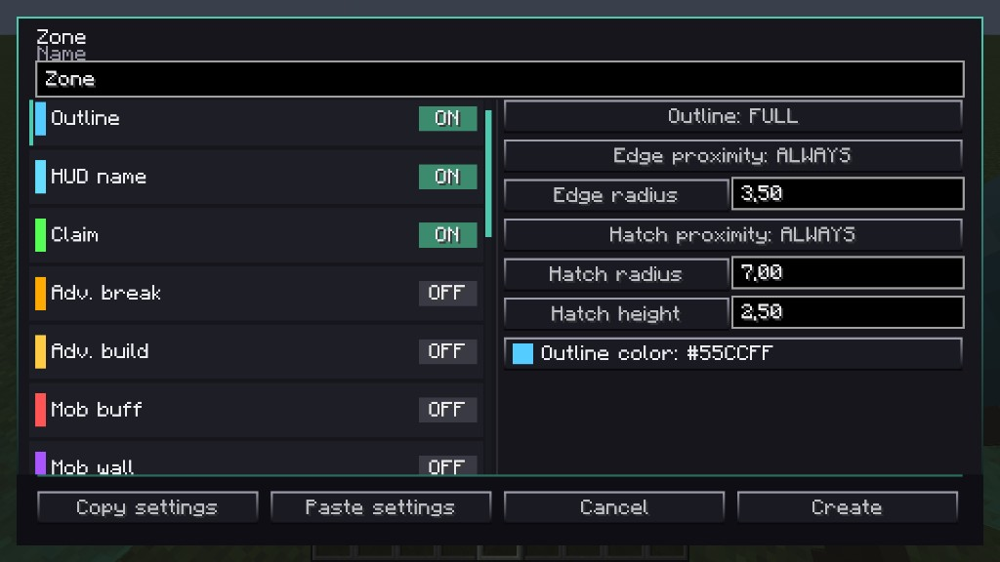
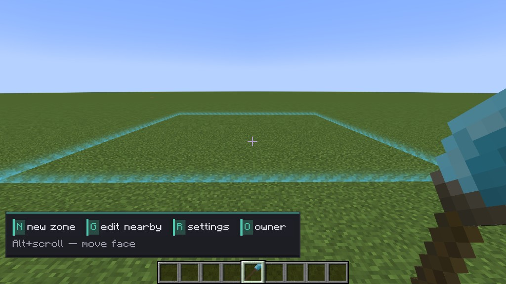
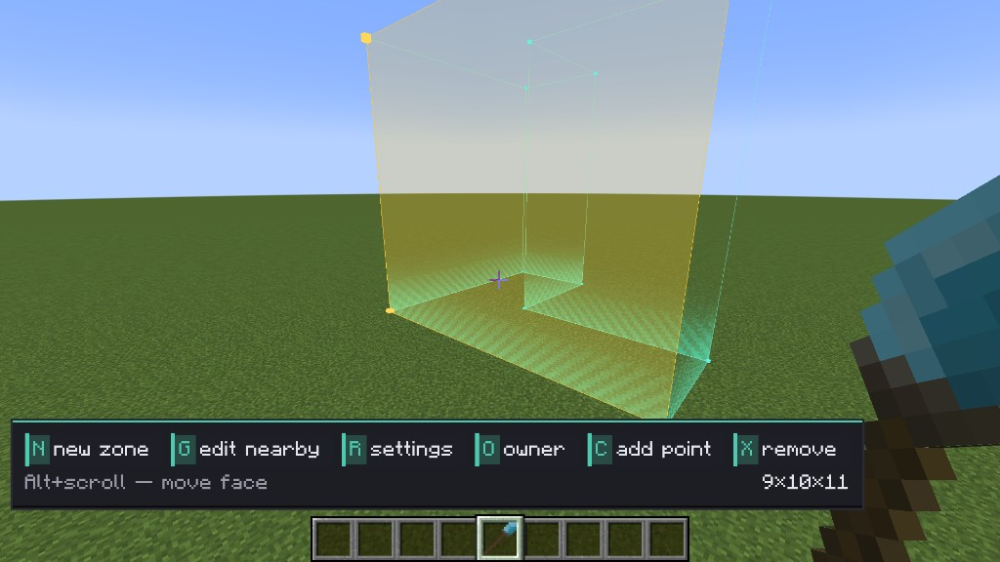

# YBLK Zones

**Minecraft Forge 1.20.1** · License **MIT** · [GitHub](https://github.com/yab1oko/yblk-zones)

Create zones. Lots of configuration options and the ability to write scripts.

## Dependencies

| | |
|---|---|
| **Required** | Minecraft **1.20.1** |
| **Required** | Forge **47.x** (47.4.0+) |
| **Optional** | none |

## Install

1. Install Forge 1.20.1  
2. Put `yblk_zones-1.20.1-1.0.0.jar` into `mods`  
3. Launch

## Features

- Zone Wand — draw and edit zones  
- Flags, HUD, ambience, particles, effects  
- Buyable plots, templates, owner tools  
- Events / raids (waves, rewards)  
- Scripts + text editor + save/import between zones  

## Screenshots

## Author

yab1oko

## License

[MIT](LICENSE)
